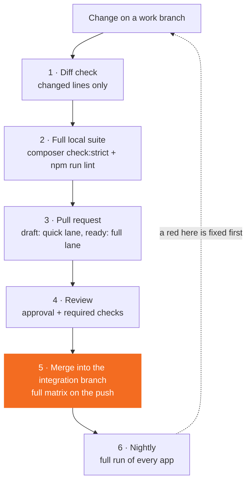
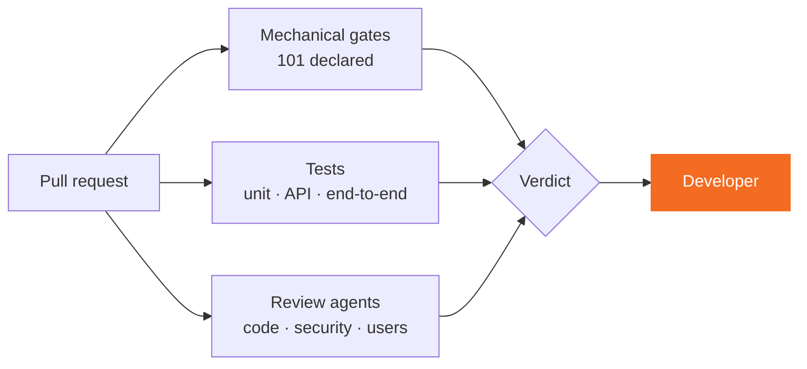

# Development pipeline

Every change passes the same steps on its way to a release. This page is the one place that describes them, and the one place that lists what we test against. Other pages link here.

## From change to merge



Each layer runs once. A whole-tree check on every edit costs hours and tells you little, because most of what it reports was there before you started.

We measured what happens otherwise. In September 2026, agent sessions spent 0.8% of their tool time editing and about 70% verifying, polling and waiting. They re-ran whole-tree checks on every iteration, against a base that was already red.

### 1. Diff check, while you build

The diff check runs the gates on the files you changed: `php -l`, PHP_CodeSniffer, PHPStan, the unit tests of the classes you touched, ESLint and Stylelint. It sorts every finding into **new** (on a line you touched) or **inherited** (on a line you did not). Only new findings count.

An inherited finding goes into the pull request description in one sentence. You fix it only when it sits in a file you are already editing and takes under fifteen minutes. The rest belongs to a separate debt sweep.

### 2. The full local suite, once, before you push

```bash
COMPOSER_PROCESS_TIMEOUT=0 composer check:strict
npm run lint
```

`composer check:strict` runs `php -l`, PHP_CodeSniffer, PHPMD, Psalm, PHPStan and then the complete PHPUnit suite, so you do not run PHPUnit again. The timeout override matters: without it composer stops the run after 300 seconds and reports a failure that is not yours.

### 3. The pull request

Every app calls one shared workflow, `quality.yml` in [ConductionNL/.github](https://github.com/ConductionNL/.github/blob/main/.github/workflows/quality.yml). What it runs depends on the event:

| Event | Lane | What runs |
| --- | --- | --- |
| Draft pull request | Quick | Lint, static analysis, frontend lint, build and unit tests, dependency and licence checks. |
| Pull request ready for review | Full | Everything the app enables, including PHPUnit, Newman, Playwright and the Hydra gates. |
| Push to an integration branch | Full | The same, with the complete PHP and Nextcloud matrix. |

Two options make a ready pull request cheaper, and apps may switch them on. Path filtering skips PHPUnit and Playwright when the diff touches no code. Matrix reduction runs PHPUnit on one PHP version and the newest Nextcloud only, for pull requests into the app's development branch (`development` unless the app lists another in `reduce-pr-base-branches`). Both apply to pull requests, never to the push after the merge.

The Hydra gates judge only the lines the pull request changed (ADR-020).

### 4. Review

A person reviews every pull request before it merges. Changes built by the [Hydra pipeline](../hydra/pipeline-overview.md) pass an agent code review and an agent security review first. Branch rules on each app require an approving review and a set of required checks.

### 5. Merge into the integration branch

The integration branch is where finished work collects before a release. We follow Nextcloud's convention, so that is `main`, with a `stableX.Y` branch per release line. Apps move over one at a time, and those that have not moved yet still integrate on `development`. [Release process](release-process.md) describes both.

The push that a merge creates runs the full lane with the complete matrix. A red result there is fixed forward, or the merge is reverted, before anything else lands.

When hosted CI is unavailable, the same steps run locally on a developer machine, and the pull request records what ran.

### 6. Nightly

The fleet drift sweep starts one full run of every app's quality workflow on its integration branch, every night at 03:00 UTC: `main` for apps on the Nextcloud branch model, `development` for the rest. It runs the whole matrix with no path filtering, so an app nobody touched is still measured against today's gates. The badges on [App health](../hydra/operations/app-health.md) show the results.

## How we know the code is good

We do not trust code because an agent wrote it carefully, or because a person did. We trust it when a machine has checked it against what we wrote down first. Three kinds of checks do that, each catching what the others miss.



### Gates come from incidents

A Hydra gate is a script that fails a pull request on one specific mistake. The package [`conduction/hydra-gates`](https://github.com/ConductionNL/.github/tree/main/hydra-gates) declares 101 of them. Most gates exist because the mistake shipped once:

| What went wrong | Where | The gate that now catches it |
| --- | --- | --- |
| Four controller methods let any logged-in user act on any object | decidesk#44 | `no-admin-idor` fails an endpoint without a per-object check |
| Authorization methods were written, and nothing called them | decidesk#60 | `orphan-auth` fails a check that no code calls |
| Endpoints could never be reached, because they had no auth attribute | decidesk#47 | `route-auth` fails a route without one |
| 41 controller methods had no route, yet their tasks were ticked as done | openregister | `route-reachability` fails both directions |
| A method shipped with no link to any requirement | fleet-wide | gate 16 requires a `@spec` tag on every changed method |
| A spec scenario shipped with no test | fleet-wide | gate 19 requires an end-to-end test for every new scenario |

Gates judge only the lines a pull request changed (ADR-020). Old debt does not block new work. A separate sweep owns it.

### A check that judged nothing says so

A gate that inspects nothing looks exactly like a gate that passed. We learned that the expensive way, so every gate reports one of three states (ADR-115):

- **Ran**, with a pass or a fail.
- **Not applicable**, with a reason, when the thing it checks is absent.
- **Skipped**, when its input or its own tooling is missing.

Each run ends with a coverage line, such as `COVERAGE: 11 of 101 declared gates reported a result (88 not applicable; 11 of 13 applicable gates ran)`. Two applicable gates that did not run are a finding, not a pass.

### Tests that can fail

A test that passes whatever the code does proves nothing. So the rules ask for tests that touch the real thing:

- **Security routes** need at least one test through the real router and middleware, not a controller built by hand (ADR-060).
- **Every UI surface** needs an end-to-end test that navigates there and asserts something specific to that page (ADR-074).
- **A spec marked implemented** must point at code that exists (ADR-060).

### Maintainability (ISO 25010)

Code that works today can still be too hard to change tomorrow. We score maintainability per app on the ISO 25010 model, from one to five stars. It counts how much code sits in units that are too long, too complex or take too many parameters, plus duplication.

Gate 122 holds the line on new work. A unit a pull request adds or edits fails when it has more than 60 lines of code, a McCabe complexity above 10, or five or more parameters. A new duplicated fragment of six lines or more fails too. A unit that was already over the bound, and did not get worse, is inherited.

The gate ships as a warning for now, so the fleet can catch up before it blocks. The current rating of every app is on the [Quality matrix](../hydra/operations/quality-scores.mdx).

#### Three ways to look at maintainability

A star rating describes one code base. What a customer pays for is the maintenance of everything they run. So we look at maintainability in three ways, and combine them:

```
maintenance cost per party = (cost of one code base × number of code bases) ÷ parties sharing the cost
```

1. **The code base itself.** How hard is this code to change? That is the star rating above.
2. **The number of code bases.** Ten simple applications are ten sets of logins, permissions, storage, updates and security fixes. Fewer code bases means less to maintain, even when each one is larger.
3. **The parties carrying the cost.** A code base that 300 organisations share costs each of them a fraction of one that 3 share.

The third factor is why we build for more than Dutch municipalities. Our apps run on any Nextcloud, for any organisation that needs them. Every extra party that uses a code base lowers the share each one pays.

#### Why one core beats many small applications

We expect municipalities to keep more than 40 registers in the coming years. The signs all point that way:

- **The government's own count.** In 2024 the State Secretary for Digitalisation listed at least 65 public government registers, and later told parliament there are more ([Kamerstuk 32761-293](https://zoek.officielebekendmakingen.nl/kst-32761-293.pdf), [Binnenlands Bestuur](https://www.binnenlandsbestuur.nl/digitaal/omgevingswet/65-openbare-overheidsregisters-bekend)).
- **The municipal data model.** VNG's Gemeentelijk Gegevensmodel (GGM) covers every policy domain of a municipality, with one domain registration per domain. More than a hundred municipalities use it ([VNG](https://vng.nl/praktijkvoorbeelden/het-gemeentelijk-gegevensmodel)).
- **The national object registry.** VNG specified the Objecttypes API so municipalities do not have to build a full API for every simple object ([VNG](https://vng.nl/projecten/overige-objecten-registratie-api)). A standard like that only exists because the number of object types keeps growing.
- **New rules add registers.** The algorithm register is on its way to becoming mandatory ([Binnenlands Bestuur](https://www.binnenlandsbestuur.nl/digitaal/traject-gestart-om-algoritmeregister-te-verplichten)), and the Wet open overheid (Woo) adds categories that must be published actively.
- **Our own apps.** The apps we build today already define 32 registers between them, with about 960 schemas.

Built the usual way, 40 registers are 40 code bases. Each one may score well on its own, and together they are 40 times the logins, permissions, updates and security fixes. One core configured 40 times scores lower as a single code base, and far better on the formula above. That is the choice behind [One core, many registers](../strategy/one-core-many-registers.md).

It pays off in features too. Every capability the core gains, every register gets at once: an audit trail, access rules, search, notifications, and APIs such as REST and GraphQL subscriptions. A small application per register would have to build each of those again, and most never would.

### Review agents

Mechanical gates catch known mistakes. Review agents catch the rest:

- **Code review** reads the diff against the ADRs and the spec.
- **Security review** adds static analysis with Semgrep and reads the code after the code review's fixes.
- **User review** runs the app as personas would. Eight persona skills test it as real users, and the feature counsel reads the specs through nine perspectives, a screen-reader user among them.

A review agent may fix what is small and in scope. Everything else it must report, and the developer decides.

## The test matrix

Read from `quality.yml` and from the apps' own `code-quality.yml` callers. "Opt-in" means an app switches it on in its caller.

### Versions and databases

| Dimension | What we test | Where it comes from |
| --- | --- | --- |
| PHP | 8.3 and 8.4 for PHPUnit; 8.3 for lint and static analysis | `php-test-versions`, `php-version` |
| Nextcloud | Every stable branch from the app's declared minimum to its declared maximum | Derived from `appinfo/info.xml` |
| Single-server jobs | Newman, Playwright and the coverage guard run on the newest of those branches | Derived |
| Database | PostgreSQL 16 for every app. OpenRegister, launchpad and keepiq also run PHPUnit on MySQL 8.4 and SQLite, since 18 November 2026; MariaDB (11.4; 12.3 on Nextcloud 35) can be listed too. A database in `database-install-matrix` gets a single install-only leg on the primary PHP and the newest Nextcloud: a real database server, a Nextcloud install and the app's migrations through `occ app:enable`, with no test suite | `database`, `database-test-matrix`, `database-install-matrix` |

Because the Nextcloud range is derived from `info.xml`, the versions an app claims to support and the versions it is tested on cannot drift apart. An app may override the range, and a gate then requires the override to agree with `info.xml`.

### Checks and test suites

| Group | Tools | Notes |
| --- | --- | --- |
| PHP quality | `php -l`, PHP_CodeSniffer, PHPMD, Psalm, PHPStan, phpmetrics | One job per tool |
| PHP tests | PHPUnit | PHP × Nextcloud × database matrix; unit, integration and database suites |
| Architecture tests | PHPUnit tests under `tests/Unit/Architecture` | Assert structure: layer boundaries, interface bindings, what may call what |
| Coverage | Coverage guard | A pull request may not lower coverage against its merge base; opt-in |
| Frontend quality | ESLint, Stylelint | Nextcloud's shared configs |
| Frontend tests | Jest or Vitest | Whichever the app's `test` script runs |
| Frontend checks | The app's own npm scripts, such as manifest, translation and spec checks | Listed per app in `frontend-checks` |
| API tests | Newman (Postman collections) | Against a freshly installed Nextcloud; opt-in |
| End-to-end tests | Playwright | Against a freshly installed Nextcloud, optionally sharded; opt-in |
| Accessibility | axe-core | WCAG 2.0, 2.1 and 2.2 A and AA rule sets; opt-in |
| Hydra gates | The mechanical gates from [`conduction/hydra-gates`](https://github.com/ConductionNL/.github/tree/main/hydra-gates) | Security, authorization, routes, spec traceability, licensing |
| Supply chain | `composer audit`, `npm audit`, licence checks, CycloneDX SBOM, lockfile sync | SBOM on integration-branch pushes |
| Compliance | REUSE lint, `info.xml` lint | |
| Rollup | Quality Report | One verdict per run, listing every leg |

The shared workflow tests itself as well. Guard tests in [`scripts/`](https://github.com/ConductionNL/.github/tree/main/scripts) fail when a job could be skipped without anyone noticing, or when the report stops waiting for a leg.

Which code standard these tools enforce, and how it relates to Nextcloud's own, is on [CI/CD and code standards](ci-cd.md).

## Next step

Before your next push, run the diff check, then `composer check:strict` once. [Contributing](contributing.md) has the pull request checklist.
