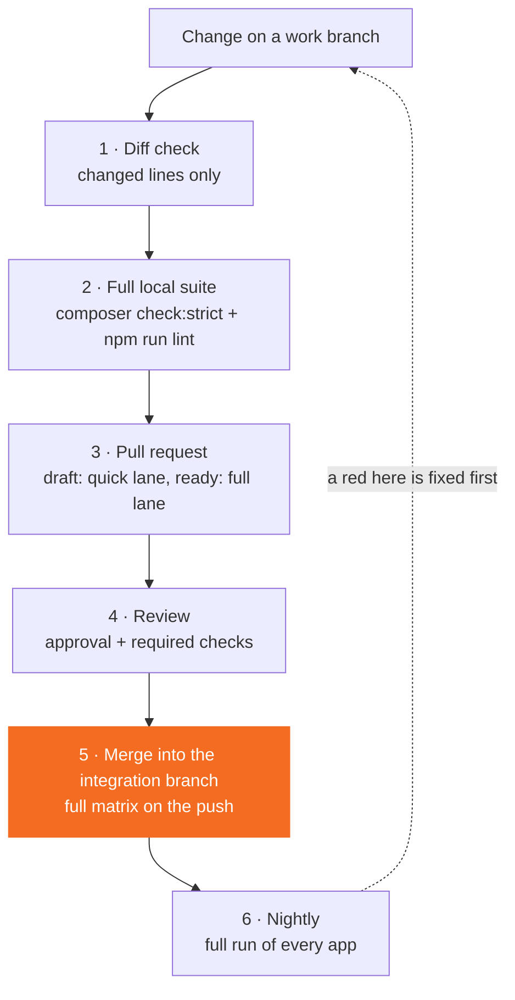

# Development pipeline

Every change passes the same steps on its way to a release. This page is the one place that describes them, and the one place that lists what we test against. Other pages link here.

## From change to merge



Each layer runs once. A whole-tree check on every edit costs hours and tells you little, because most of what it reports was there before you started.

### 1. Diff check, while you build

The diff check runs the gates on the files you changed: `php -l`, PHP_CodeSniffer, PHPStan, the unit tests of the classes you touched, ESLint and Stylelint. It sorts every finding into **new** (on a line you touched) or **inherited** (on a line you did not). Only new findings count.

An inherited finding goes into the pull request description in one sentence. You fix it only when it sits in a file you are already editing and takes under fifteen minutes. The rest belongs to a separate debt sweep.

### 2. The full local suite, once, before you push

```bash
COMPOSER_PROCESS_TIMEOUT=0 composer check:strict
npm run lint
```

`composer check:strict` runs `php -l`, PHP_CodeSniffer, PHPMD, Psalm, PHPStan and then the complete PHPUnit suite, so you do not run PHPUnit again. The timeout override matters: without it composer stops the run after 300 seconds and reports a failure that is not yours.

### 3. The pull request

Every app calls one shared workflow, `quality.yml` in [ConductionNL/.github](https://github.com/ConductionNL/.github/blob/main/.github/workflows/quality.yml). What it runs depends on the event:

| Event | Lane | What runs |
| --- | --- | --- |
| Draft pull request | Quick | Lint, static analysis, frontend lint, build and unit tests, dependency and licence checks. |
| Pull request ready for review | Full | Everything the app enables, including PHPUnit, Newman, Playwright and the Hydra gates. |
| Push to an integration branch | Full | The same, with the complete PHP and Nextcloud matrix. |

Two options make a ready pull request cheaper, and apps may switch them on. Path filtering skips PHPUnit and Playwright when the diff touches no code. Matrix reduction runs PHPUnit on one PHP version and the newest Nextcloud only, for pull requests into the app's development branch (`development` unless the app lists another in `reduce-pr-base-branches`). Both apply to pull requests, never to the push after the merge.

The Hydra gates judge only the lines the pull request changed (ADR-020).

### 4. Review

A person reviews every pull request before it merges. Changes built by the [Hydra pipeline](../hydra/pipeline-overview.md) pass an agent code review and an agent security review first. Branch rules on each app require an approving review and a set of required checks.

### 5. Merge into the integration branch

The integration branch is where finished work collects before a release. For most apps that is `development`. Apps that moved to the Nextcloud branch model integrate on `main`, with `stableX.Y` branches for releases. [Release process](release-process.md) describes both models.

The push that a merge creates runs the full lane with the complete matrix. A red result there is fixed forward, or the merge is reverted, before anything else lands.

When hosted CI is unavailable, the same steps run locally on a developer machine, and the pull request records what ran.

### 6. Nightly

The fleet drift sweep starts one full run of every app's quality workflow on `development`, every night at 03:00 UTC. It runs the whole matrix with no path filtering, so an app nobody touched is still measured against today's gates. The badges on [App health](../hydra/operations/app-health.md) show the results.

## The test matrix

Read from `quality.yml` and from the apps' own `code-quality.yml` callers. "Opt-in" means an app switches it on in its caller.

### Versions and databases

| Dimension | What we test | Where it comes from |
| --- | --- | --- |
| PHP | 8.3 and 8.4 for PHPUnit; 8.3 for lint and static analysis | `php-test-versions`, `php-version` |
| Nextcloud | Every stable branch from the app's declared minimum to its declared maximum | Derived from `appinfo/info.xml` |
| Single-server jobs | Newman, Playwright and the coverage guard run on the newest of those branches | Derived |
| Database | PostgreSQL 16 by default; MySQL 8.4, MariaDB (11.4; 12.3 on Nextcloud 35) and SQLite opt-in | `database`, `database-test-matrix` |

Because the Nextcloud range is derived from `info.xml`, the versions an app claims to support and the versions it is tested on cannot drift apart. An app may override the range, and a gate then requires the override to agree with `info.xml`.

### Checks and test suites

| Group | Tools | Notes |
| --- | --- | --- |
| PHP quality | `php -l`, PHP_CodeSniffer, PHPMD, Psalm, PHPStan, phpmetrics | One job per tool |
| PHP tests | PHPUnit | PHP × Nextcloud × database matrix; unit, integration and database suites |
| Architecture tests | PHPUnit tests under `tests/Unit/Architecture` | Assert structure: layer boundaries, interface bindings, what may call what |
| Coverage | Coverage guard | A pull request may not lower coverage against its merge base; opt-in |
| Frontend quality | ESLint, Stylelint | Nextcloud's shared configs |
| Frontend tests | Jest or Vitest | Whichever the app's `test` script runs |
| Frontend checks | The app's own npm scripts, such as manifest, translation and spec checks | Listed per app in `frontend-checks` |
| API tests | Newman (Postman collections) | Against a freshly installed Nextcloud; opt-in |
| End-to-end tests | Playwright | Against a freshly installed Nextcloud, optionally sharded; opt-in |
| Accessibility | axe-core | WCAG 2.0, 2.1 and 2.2 A and AA rule sets; opt-in |
| Hydra gates | The mechanical gates from [`conduction/hydra-gates`](https://github.com/ConductionNL/.github/tree/main/hydra-gates) | Security, authorization, routes, spec traceability, licensing |
| Supply chain | `composer audit`, `npm audit`, licence checks, CycloneDX SBOM, lockfile sync | SBOM on integration-branch pushes |
| Compliance | REUSE lint, `info.xml` lint | |
| Rollup | Quality Report | One verdict per run, listing every leg |

The shared workflow tests itself as well. Guard tests in [`scripts/`](https://github.com/ConductionNL/.github/tree/main/scripts) fail when a job could be skipped without anyone noticing, or when the report stops waiting for a leg.

Which code standard these tools enforce, and how it relates to Nextcloud's own, is on [CI/CD and code standards](ci-cd.md).

## Next step

Before your next push, run the diff check, then `composer check:strict` once. [Contributing](contributing.md) has the pull request checklist.
