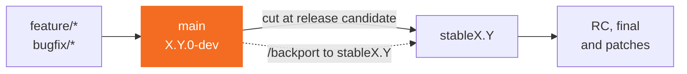

# Release Process

This document describes how we version, build, and release our Nextcloud apps. All release workflows are centralized in the [Conduction/.github](https://github.com/ConductionNL/.github) repository and shared across all app repositories.

## Branch model

We follow Nextcloud's own convention (ADR-122). `main` is the development branch. Each minor version gets a `stableX.Y` branch, and releases come from there.



- **Work lands on `main`.** Its `appinfo/info.xml` carries the next version as `X.Y.0-dev`. A push to `main` makes a GitHub prerelease `X.Y.0-dev.<timestamp>`, with no App Store upload.
- **Betas come from `main`** until the line is cut, as `X.Y.Z-beta.N`.
- **Each minor line gets a `stableX.Y` branch** when it reaches release candidate. Release candidates, finals and patches come from that branch only.
- **Fixes land on `main` first.** Comment `/backport to stableX.Y` on the merged pull request. The backport workflow cherry-picks the commits and opens a pull request into the stable branch. Nothing is merged upward.
- **The version is committed.** A release ships exactly the version in the branch's `info.xml`, and the tag must match it. To release, raise the version with a `release/vX.Y.Z` pull request on the stable branch first. PR labels play no part.

### Branch rules

| Target branch | Allowed source branches | What happens on merge |
| --- | --- | --- |
| `main` | `feature/*`, `bugfix/*` and other work branches | GitHub prerelease, no App Store upload |
| `stableX.Y` | `backport/*`, `release/v*`, `hotfix/*`, `dependabot/*` | Release candidates and releases for that line |
| `development`, `beta` | None. Both are locked on an app that has moved | |

The centralized **branch-protection** workflow enforces these rules and blocks pull requests from other branches.

### Moving an app over

Apps move to this model one at a time. OpenRegister moved first, on 9 November 2026. An app that has moved sets `branch-model: main` in its release and branch-protection callers, and is listed under `main-branch` in [`fleet-apps.json`](https://github.com/ConductionNL/.github/blob/main/fleet-apps.json). Its `development` and `beta` branches are locked, their last commit is tagged, and they are deleted after 30 days.

### Apps that have not moved yet

Until an app moves, it keeps the older three-tier model. Code flows upward through the tiers:

```
feature/* ─┐
bugfix/*  ─┼──► development ──► beta ──► main
hotfix/*  ─┘        │              │        │
                    │         Beta build  Stable build
               No builds      (nightly)   (App Store)
```

| Target branch | Allowed source branches             | What happens on merge                                 |
| ------------- | ----------------------------------- | ----------------------------------------------------- |
| `development` | `feature/*`, `bugfix/*`, `hotfix/*` | Nothing, no builds triggered                          |
| `beta`        | `development`, `hotfix/*`, `main`   | Beta release built and pushed as nightly to App Store |
| `main`        | `beta`, `hotfix/*`                  | Stable release built and pushed to App Store          |

Hotfix branches (`hotfix/*`) may target `beta` and `main` directly, for critical production fixes only. They get the same review and CI as any other pull request. After a hotfix merges to `main`, open a pull request from `main` to `beta` to keep the branches in sync.

The rest of this page, from versioning onwards, describes this older model. On the Nextcloud model, the version comes from `info.xml`, as described above.

## Versioning

We use [Semantic Versioning](https://semver.org/) (semver). Versions are **calculated automatically** from PR labels — you never need to edit `appinfo/info.xml` manually.

### PR Labels

Every PR should have one of these labels:

| Label   | When to use                                       | Example             |
| ------- | ------------------------------------------------- | ------------------- |
| `patch` | Bug fixes, small improvements, dependency updates | `0.2.13` → `0.2.14` |
| `minor` | New features, significant enhancements            | `0.2.13` → `0.3.0`  |
| `major` | Breaking changes, major rewrites                  | `0.2.13` → `1.0.0`  |

If no label is set, the version defaults to a **patch** bump.

### How Versions Are Calculated

**Stable releases** (on merge to `main`):

1. The workflow reads the latest stable git tag (e.g., `v0.2.13`)
2. It checks the PR labels for `major`, `minor`, or `patch`
3. It bumps the version accordingly (e.g., `0.2.14` for patch)
4. The new version is injected into `info.xml` inside the release tarball only
5. A git tag `v0.2.14` is created

**Beta releases** (on merge to `beta`):

1. The workflow reads the latest stable git tag (e.g., `v0.2.13`)
2. It always bumps the patch version by one (e.g., `0.2.14`)
3. It appends a beta suffix with a UTC timestamp: `0.2.14-beta.20260313143022`
4. The version is injected into the tarball's `info.xml`
5. A git tag `v0.2.14-beta.20260313143022` is created

### Important: Version Is Not In The Repository

The `appinfo/info.xml` in your repository is **never modified** by the release workflow. The version is only injected into the packaged tarball that gets uploaded to the App Store. This means:

- No `[skip ci]` version bump commits cluttering your git history
- No merge conflicts from version bumps
- The repo's `info.xml` serves as a baseline only (the initial version before any tags exist)

## Release Channels

| Channel    | Branch | App Store flag   | Who uses it                                             |
| ---------- | ------ | ---------------- | ------------------------------------------------------- |
| **Stable** | `main` | `nightly: false` | Production users, default install                       |
| **Beta**   | `beta` | `nightly: true`  | Testers, early adopters (opt-in via App Store settings) |

In addition, 14 of the 18 core apps ship a `release-development.yml` that calls the shared beta
release workflow with `channel: dev` on every push to `development`. The `dev` channel is a **GitHub
prerelease only** — it shares the beta packaging path but never POSTs to
`apps.nextcloud.com`, so it is not an App Store channel. It exists so work on `development` can
be installed before it reaches beta. Developers otherwise test locally or install from beta.

## Automatic PR Sync

When you push to `development`, a workflow automatically creates (or updates) a PR from `development` → `beta`. This PR:

- Keeps the beta channel up to date
- Shows you exactly what will be in the next beta release
- Reminds you to add a version label (`major`/`minor`/`patch`)

## Workflow Setup for Your App

To adopt the centralized release workflows, create these thin caller files in your app's `.github/workflows/` directory:

### Stable Release (`release-stable.yml`)

```yaml
name: Stable Release

on:
  push:
    branches: [main]

jobs:
  release:
    uses: Conduction/.github/.github/workflows/release-stable.yml@main
    with:
      app-name: your-app-name
    secrets: inherit
```

### Beta Release (`release-beta.yml`)

```yaml
name: Beta Release

on:
  push:
    branches: [beta]

jobs:
  release:
    uses: Conduction/.github/.github/workflows/release-beta.yml@main
    with:
      app-name: your-app-name
    secrets: inherit
```

### Branch Protection (`branch-protection.yml`)

```yaml
name: Branch Protection

on:
  pull_request:
    branches: [main, beta]

jobs:
  check:
    uses: Conduction/.github/.github/workflows/branch-protection.yml@main
```

### Sync Development to Beta (`sync-to-beta.yml`)

```yaml
name: Sync to Beta

on:
  push:
    branches: [development]

jobs:
  sync:
    uses: Conduction/.github/.github/workflows/sync-to-beta.yml@main
```

### Apps With Special Vendor Dependencies

If your app has critical vendor dependencies that must be verified (like OpenRegister with openai-php/client), add the verification inputs:

```yaml
jobs:
  release:
    uses: Conduction/.github/.github/workflows/release-stable.yml@main
    with:
      app-name: openregister
      verify-vendor-deps: true
      vendor-check-paths: "openai-php/client/src,theodo-group/llphant/src"
    secrets: inherit
```

## Required Repository Secrets

Each app repository needs these secrets configured:

| Secret                     | Purpose                                            |
| -------------------------- | -------------------------------------------------- |
| `NEXTCLOUD_SIGNING_KEY`    | Private key for signing the release tarball        |
| `NEXTCLOUD_APPSTORE_TOKEN` | API token for uploading to the Nextcloud App Store |

## Migration from Old Workflows

If your app currently has its own release workflows (e.g., `release-workflow.yaml`, `beta-release.yaml`, `unstable-release.yaml`):

1. **Tag your current version**: Before switching, create a git tag on `main` for the current version:

   ```bash
   git tag v$(grep -oP '(?<=<version>)[^<]+' appinfo/info.xml | sed 's/-.*//') main
   git push origin --tags
   ```

2. **Replace the old workflows** with the thin caller files shown above

3. **Remove obsolete workflows**:
   - `unstable-release.yaml` (no more development builds)
   - `push-development-to-beta.yaml` (replaced by `sync-to-beta.yml`)
   - `pull-request-from-branch-check.yaml` (replaced by `branch-protection.yml`)

4. **Keep app-specific workflows** that are unique to your app (e.g., `sync-tokens.yml` in nldesign)

## FAQ

**Q: What if I forget to label my PR?**
A: The version defaults to a `patch` bump. You can always add a label before merging.

**Q: Can I do a manual release?**
A: The stable workflow currently only triggers on push to `main`. If you need a manual release, you can trigger a workflow_dispatch from the Actions tab (if your caller workflow supports it).

**Q: How do I know what version will be released?**
A: Check the latest git tag with `git tag -l 'v*' --sort=-v:refname | head -1`, then mentally apply the PR label bump.

**Q: What about the Nextcloud App Store version compatibility (`<nextcloud min-version>`)?**
A: This is still managed in your repo's `appinfo/info.xml`. Only the `<version>` tag is overwritten in the tarball — all other fields (name, description, nextcloud version requirements, etc.) come from your repo as-is.

## Further Reading

- **Centralized workflows**: [github.com/ConductionNL/.github](https://github.com/ConductionNL/.github/tree/main/.github/workflows) — all shared workflow definitions
- **Branch protection**: [`.github/workflows/branch-protection.yml`](https://github.com/ConductionNL/.github/blob/main/.github/workflows/branch-protection.yml)
- **Release workflows**: [`release.yml`](https://github.com/ConductionNL/.github/blob/main/.github/workflows/release.yml), [`release-beta.yml`](https://github.com/ConductionNL/.github/blob/main/.github/workflows/release-beta.yml), [`release-stable.yml`](https://github.com/ConductionNL/.github/blob/main/.github/workflows/release-stable.yml)
- **Semantic Versioning**: [semver.org](https://semver.org)
