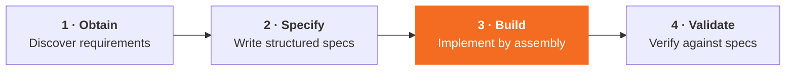
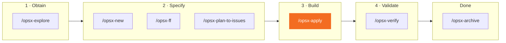

# Spec-driven development

We write down what we are building before we build it. Every change starts as a set of structured files in the app's repository. Those files stay next to the code, so the next person, or the next agent session, can see why the code is the way it is.

## The four stages

Each stage feeds the next. Discovery becomes specs, specs become software, and software is checked against the specs that produced it.



- **Obtain.** Requirements come from issues, tenders, user feedback and research. The output is a shared picture of what to build.
- **Specify.** The change gets a proposal, delta specs, a design and a task list.
- **Build.** We assemble the change from the platform's building blocks and write the tests with it.
- **Validate.** Tests, gates and a verify pass check the result against the spec. How that runs, step by step, is on [Development pipeline](development-pipeline.md).

## Where specs and decisions live

There are three layers. Each fact has one home, and the other layers link to it instead of copying it.

| Layer | Where | What it holds |
| --- | --- | --- |
| Company-wide decisions | Hydra, `openspec/architecture/` | The ADRs every app follows. Public index: [Architecture decisions](architecture-decisions.md). |
| Company-wide specs | Hydra, `openspec/specs/` | Capabilities shared by several apps, such as i18n, the app manifest and fleet-wide consumption of audit trail, RBAC and tenancy. |
| App decisions and specs | Each app, `openspec/` | `architecture/` for decisions that apply to that app only, `specs/` for what the app does now, `changes/` for work in flight. |

Hydra is our internal pipeline repository. It is private, which is why the ADRs have a public index on this site.

Three rules keep the layers honest:

- **A decision that applies to two or more apps is company-wide.** A decision about one app's data model, storage or domain stays in that app. [Writing ADRs](../claude/writing-adrs.md) has the details.
- **Apps do not carry copies of company-wide ADRs.** Copies drift. An app refers to the ADR by number.
- **A spec exists when it is on the app's default branch.** Content on a side branch is input, not state (ADR-056).

## The OpenSpec flow

[OpenSpec](https://github.com/Fission-AI/OpenSpec) is the format. A change is a folder, `openspec/changes/<change-name>/`, and moves through six steps.

```
proposal ──► specs + design ──► tasks ──► apply ──► verify ──► archive
```

1. **Proposal.** `proposal.md` says what changes and why: the problem, the scope, who is affected.
2. **Specs and design.** `specs/<capability>/spec.md` holds the delta: requirements marked ADDED, MODIFIED, REMOVED or RENAMED, each with GIVEN/WHEN/THEN scenarios. `design.md` holds the technical approach. The format is on [Writing specs](../claude/writing-specs.md).
3. **Tasks.** `tasks.md` breaks the work into small units. Each task points at the requirement it implements and names its tests.
4. **Apply.** The tasks are implemented. Code carries `@spec` tags that point back to the task, so every method can be traced to the requirement behind it.
5. **Verify.** The implementation is checked against the artifacts: every task done, every requirement implemented, every new service and component tested.
6. **Archive.** The delta specs are merged into `openspec/specs/`, which always describes what the app does today. The change folder moves to `openspec/changes/archive/YYYY-MM-DD-<change-name>/` and stays there as the record.

Tasks can become GitHub issues with `/opsx-plan-to-issues`, so progress is visible on the board.

## The commands

We drive the flow with Claude Code. Each step has a command, maintained as a Claude Code skill in Hydra. Most changes need only `/opsx-ff`, `/opsx-apply`, `/opsx-verify` and `/opsx-archive`.



Every command, with its options, is on the [OpenSpec command reference](../claude/commands-openspec.md).

## Build by assembly

Claude acts as an architect and assembler. It defines, configures and validates. The platform's building blocks do the work:

<cn-arch-flow arrow="none">
  <span>@conduction/nextcloud-vue</span>
  <span accent>OpenRegister</span>
  <span>OpenRegister flows</span>
</cn-arch-flow>
<cn-arch-flow arrow="none">
  <span>Components &amp; manifest pages</span>
  <span accent>Registers, schemas &amp; validation</span>
  <span>Triggers &amp; steps</span>
</cn-arch-flow>

- **Frontend.** Pages are configuration in the app's manifest, rendered by `@conduction/nextcloud-vue` components (ADR-024, ADR-071).
- **Data.** OpenRegister holds all domain data. A change defines registers, schemas and validation; the runtime is the same in every app (ADR-001, ADR-070).
- **Logic.** Behaviour a schema can declare is declared in the schema (ADR-031). Workflows run on OpenRegister's flow engine (ADR-065, ADR-094).

Why we build this way is on [One core, many registers](../strategy/one-core-many-registers.md).

## Next step

Starting a change? Read [Writing specs](../claude/writing-specs.md), then run `/opsx-new <change-name>` in the app's repository.
