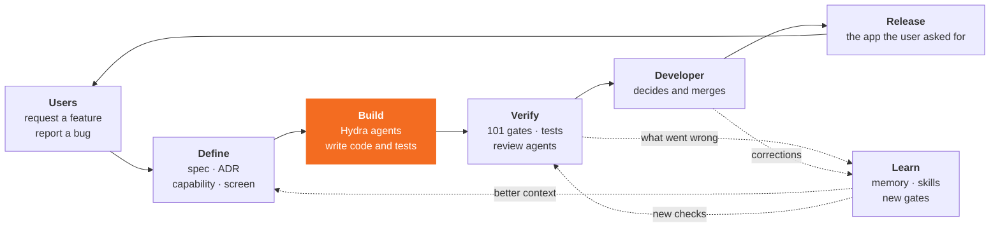
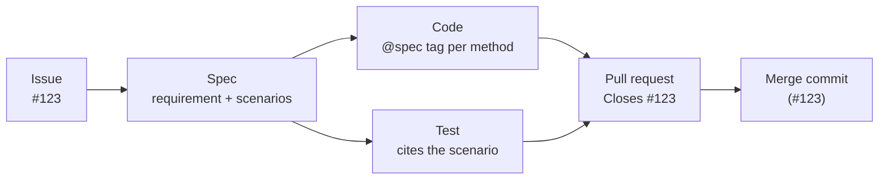
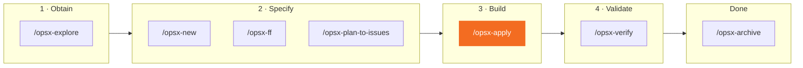

# The code factory

Most of our code is written by AI agents. We do not trust that code, and we never trusted code from a new intern either. An intern gets a brief, a mentor, a style guide and a reviewer. Our agents get the same, in a form a machine can check.

This page shows how the pieces fit together. Each piece has its own page, linked from here.

## The loop



1. **Demand.** Users ask for features from inside every app. The request lands as a GitHub issue that names the widget it came from. See [Users are the moat](../strategy/users-are-the-moat.md).
2. **Define.** Before anyone writes code, we write down what it must do. That is a spec with scenarios, a decision record, a capability row and a drawn screen. This page covers it below.
3. **Build.** Hydra's agents turn the spec into a pull request, tests included. See [Hydra](../hydra/README.md).
4. **Verify.** Gates, test suites and review agents check the pull request against the definition. See [Development pipeline](development-pipeline.md).
5. **Decide.** A developer reads the result and merges it, or sends it back.
6. **Learn.** Every mistake that cost time becomes a memory, a sharper skill or a new gate. See [The learning loop](../hydra/learning-loop.md).

## Why we do not trust the model

A language model writes plausible code. Plausible code compiles, reads well and is wrong often enough to matter. It invents a function that does not exist. It adds an authorization check that nothing calls. It writes a test that passes whatever the code does.

We have seen each of these in our own pull requests. Telling the model to be careful did not stop them. Two things did:

- **Context before the code.** The agent works from a written definition, not from a prompt. It knows what to build, which decisions bind it and what the screen looks like.
- **Tests after the code.** A machine checks the result against that same definition. Nobody has to take the agent's word for it.

A developer sits between the two. The agents do the typing. The developer owns the decisions and the merge.

## Defining first is test-driven development

Every requirement in a spec carries scenarios in GIVEN/WHEN/THEN form (ADR-038). A scenario is a test case written before the code exists. Gate 19 fails a pull request when a new scenario has no end-to-end test that cites it.

The other definitions work the same way:

| We define | Before the code, it says | After the code, it checks |
| --- | --- | --- |
| A **spec** | What the app must do, as scenarios | Each scenario has a Playwright test (gate 19) |
| An **ADR** | Which architecture choices bind every app | Gates enforce the mechanical ones, review agents read the rest |
| A **capability** | Which feature we have, compared with other products | The matrix shows whether it is in production, in build or only requested |
| A **screen** | What the page looks like, drawn on a board | The built page is compared with the board |

So the tests exist before the implementation, which is the whole point of test-driven development. We only changed who writes the implementation.

## Spec references give accountability

Every changed method carries a `@spec` tag that points at the requirement it implements. Gate 16 fails a pull request when a changed method has none. A method that implements no requirement must say why, with `@spec exclude <reason>`.



Pick any line of code and you can walk back to the requirement, the issue and the person who asked for it. You can walk forward too: from a requirement to the code and the tests that prove it. When a reviewer asks why a method exists, the answer is in the file.

Artifacts an agent creates carry a mark that says so (ADR-088). A reader can always tell agent work from human work.

## The developer in the middle

The agents never decide what to build, and they never merge on their own authority. The developer does four things the factory cannot:

- **Chooses.** Which request becomes a spec, and which decision becomes an ADR.
- **Answers.** Agents batch their open questions and ask them once, at the start. Measured in September 2026, 260 questions asked mid-run stopped sessions for 37 hours in total. Now an unattended run makes the call and writes its assumption in the pull request.
- **Merges.** A Hydra pull request waits for a human approval. In a developer's own agent session, the agent may merge on local green, but only on that developer's standing order.
- **Corrects.** A correction goes into memory or a skill, so the next session starts with it. Repeating it in chat helps only the current session.

## Where specs and decisions live

Each fact has one home. Other places link to it instead of copying it.

| Layer | Where | What it holds |
| --- | --- | --- |
| Company-wide decisions | Hydra, `openspec/architecture/` | More than 110 ADRs every app follows. Public index: [Architecture decisions](architecture-decisions.md). |
| Company-wide specs | Hydra, `openspec/specs/` | Capabilities shared by several apps, such as i18n, the app manifest and fleet-wide consumption of audit trail, RBAC and tenancy. |
| App decisions and specs | Each app, `openspec/` | `architecture/` for decisions that apply to that app only, `specs/` for what the app does now, `changes/` for work in flight. |
| Capabilities | Each app, `openspec/parity/capabilities.json` | Every feature, linked to its specs, compared with the products a customer would otherwise buy. |
| Screens | Design system, on [identity.conduction.nl/screens](https://identity.conduction.nl/screens/) | Drawn boards for every page. For layout and look, the board wins over the spec, and the spec is amended to match. |

Hydra is our internal pipeline repository. It is private, which is why the ADRs have a public index on this site.

Three rules keep the layers honest:

- **A decision that applies to two or more apps is company-wide.** A decision about one app's data model, storage or domain stays in that app. [Writing ADRs](../claude/writing-adrs.md) has the details.
- **Apps do not carry copies of company-wide ADRs.** Copies drift. An app refers to the ADR by number.
- **A spec exists when it is on the app's default branch.** Content on a side branch is input, not state (ADR-056).

## The OpenSpec flow

[OpenSpec](https://github.com/Fission-AI/OpenSpec) is the format. A change is a folder, `openspec/changes/<change-name>/`, and moves through six steps.

```
proposal ──► specs + design ──► tasks ──► apply ──► verify ──► archive
```

1. **Proposal.** `proposal.md` says what changes and why: the problem, the scope, who is affected.
2. **Specs and design.** `specs/<capability>/spec.md` holds the delta: requirements marked ADDED, MODIFIED, REMOVED or RENAMED, each with GIVEN/WHEN/THEN scenarios. `design.md` holds the technical approach. The format is on [Writing specs](../claude/writing-specs.md).
3. **Tasks.** `tasks.md` breaks the work into small units. Each task points at the requirement it implements and names its tests.
4. **Apply.** The tasks are implemented. Code carries `@spec` tags that point back to the task, so every method can be traced to the requirement behind it.
5. **Verify.** The implementation is checked against the artifacts: every task done, every requirement implemented, every new service and component tested.
6. **Archive.** The delta specs are merged into `openspec/specs/`, which always describes what the app does today. The change folder moves to `openspec/changes/archive/YYYY-MM-DD-<change-name>/` and stays there as the record.

Tasks can become GitHub issues with `/opsx-plan-to-issues`, so progress is visible on the board.

## The commands

We drive the flow with Claude Code. Each step has a command, maintained as a Claude Code skill in Hydra. Most changes need only `/opsx-ff`, `/opsx-apply`, `/opsx-verify` and `/opsx-archive`.



Every command, with its options, is on the [OpenSpec command reference](../claude/commands-openspec.md).

## Build by assembly

Claude acts as an architect and assembler. It defines, configures and validates. The platform's building blocks do the work:

<cn-arch-flow arrow="none">
  <span>@conduction/nextcloud-vue</span>
  <span accent>OpenRegister</span>
  <span>OpenRegister flows</span>
</cn-arch-flow>
<cn-arch-flow arrow="none">
  <span>Components &amp; manifest pages</span>
  <span accent>Registers, schemas &amp; validation</span>
  <span>Triggers &amp; steps</span>
</cn-arch-flow>

- **Frontend.** Pages are configuration in the app's manifest, rendered by `@conduction/nextcloud-vue` components (ADR-024, ADR-071).
- **Data.** OpenRegister holds all domain data. A change defines registers, schemas and validation; the runtime is the same in every app (ADR-001, ADR-070).
- **Logic.** Behaviour a schema can declare is declared in the schema (ADR-031). Workflows run on OpenRegister's flow engine (ADR-065, ADR-094).

Why we build this way is on [One core, many registers](../strategy/one-core-many-registers.md).

## Next step

Starting a change? Read [Writing specs](../claude/writing-specs.md), then run `/opsx-new <change-name>` in the app's repository.
