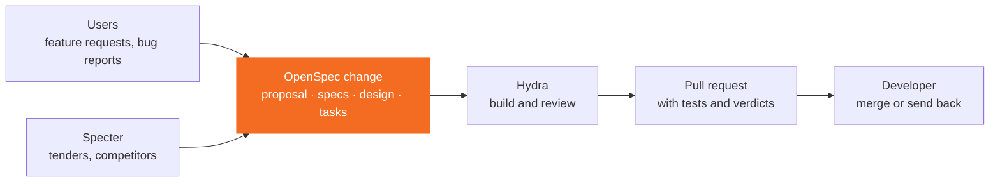
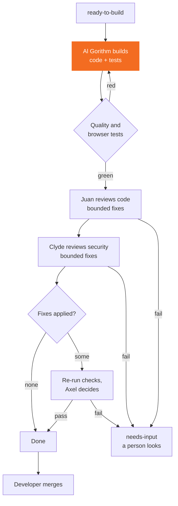

# Hydra

Hydra is the part of the [code factory](../WayOfWork/spec-driven-development.md) that writes code. It takes an OpenSpec change and runs it past four agents. Out comes a pull request with its tests, its reviews and a verdict. A developer decides whether it lands.

Hydra lives in [ConductionNL/hydra](https://github.com/ConductionNL/hydra), a private repository. The apps it builds are public, under [ConductionNL](https://github.com/ConductionNL).

## Where the work comes from

Two streams feed the specs:

- **Users.** A request filed from inside an app becomes an issue. A `needs-spec` label makes Hydra write the spec for it. [Users are the moat](../strategy/users-are-the-moat.md) describes that path.
- **Specter.** Our research pipeline reads public tenders and competitor documentation. It turns them into capability rows and spec changes, and opens an issue that starts the build.

Hydra never builds from a prompt. If no spec exists, there is nothing to build.

## The agents

Each agent runs in its own container, with its own token and its own narrow job. They all default to Sonnet.

| Agent | Role | May change code? |
| --- | --- | --- |
| **Al Gorithm** | Builder. Implements the tasks, writes the tests, opens the pull request | Yes |
| **Juan Claude van Damme** | Code reviewer. Reads the diff against the ADRs and the spec | Bounded fixes only |
| **Clyde Barcode** | Security reviewer. Adds Semgrep and reads the code after Juan's fixes | Bounded fixes only |
| **Axel Pliér** | Applier. Gives the final go or no-go | No |

The split is deliberate. The agent that writes the code never judges it. The agent that judges it last cannot change it, so it has no reason to grade its own fixes kindly.

## How a change moves

- **Build.** Al Gorithm pushes the branch early and runs the quality checks and the Playwright scenarios. A red result goes back to the builder for a bounded fix round.
- **Review.** Juan, then Clyde, read the diff. They run one after the other, because they share the branch. Each may fix what is small and in scope, and must report the rest.
- **Decide.** When the reviewers fixed nothing, the change is done. When they did fix something, the checks run again, and Axel reads the final diff.
- **Escalate.** Any failure ends in `needs-input`. Hydra does not retry in a loop (ADR-013). A person reads what went wrong and chooses `retry:queued` or `rebuild:queued`.

The full state machine, with every label, is on [Pipeline overview](pipeline-overview.md).

## The developer in the middle

The agents type. The developer decides, and nothing in Hydra takes that away:

- **Before the build,** the developer approves the spec. A spec that missed the point is cheap to fix here.
- **During the build,** the developer answers `needs-input`. The pipeline stops instead of guessing.
- **After the build,** the developer reviews and merges. The `yolo` label skips that last approval, and it is only for small changes the developer has already judged.

A developer also works next to Hydra, with Claude Code in their own session. The same skills, gates and review agents run there. [Using Hydra](../claude/README.md) covers that way of working.

## How to start Hydra

You start Hydra with labels.

1. **Build from a spec.** Add `ready-to-build` to an issue that links an OpenSpec change.
2. **Write the spec first.** Add `needs-spec` to an issue. Hydra writes the change, then builds it.
3. **Review an existing pull request.** Add `code-review:queued`. Add `security-review:queued` after the code review finishes. Setting both at once causes conflicts.
4. **Recover.** After `needs-input`, use `retry:queued` to fix the flagged findings, or `rebuild:queued` to start over.

## Hydra repo vs .github repo

> **Hydra is the factory. `.github` is the manual.**

Two separate repos, two distinct purposes, no overlap:

| | **[`ConductionNL/hydra`](https://github.com/ConductionNL/hydra)** *(private)* | **[`ConductionNL/.github`](https://github.com/ConductionNL/.github)** *(public)* |
|---|---|---|
| **What it contains** | Container images, agent personas, orchestration scripts, the `.claude/skills/` catalogue (`hydra-gate-*`, `opsx-*`, `test-*`), OpenSpec changes, K8s manifests | Developer guides (`docs/claude/`), Way-of-Work and onboarding (`docs/WayOfWork/`), the public Hydra one-pager (`docs/hydra/`), ISO compliance (`docs/iso/`), global Claude settings (`global-settings/`), the usage-tracker tool |
| **What it's for** | *Running* the pipeline: everything that executes | *Reading and configuring*: everything you study, install once per machine, or hand to a new colleague |
| **Clone it when** | You want to run Hydra locally, modify a skill, inspect agent configs, or browse the OpenSpec change backlog | You want to read the docs offline, install the mandatory global Claude settings, or contribute to the developer handbook |
| **Self-description** | "Factory, not the product", from [`hydra/README.md`](https://github.com/ConductionNL/hydra/blob/main/README.md) and [`hydra/CLAUDE.md`](https://github.com/ConductionNL/hydra/blob/main/CLAUDE.md) | "Central hub for org-level defaults, developer guides, global tooling configuration, and shared documentation", from [`.github/README.md`](https://github.com/ConductionNL/.github/blob/main/README.md) |

Each repo has its own `docs/` directory, and that's not a duplication: **Hydra's `docs/`** covers pipeline internals (container architecture, secrets, cron, retrospectives), which matter only if you operate the pipeline. **`.github/docs/`** is for everyone using the pipeline as a consumer.

Most developers only need `.github`. You only need the Hydra clone when you're working *on* the pipeline (skills, agents, container images) rather than *with* it (triggering it on your PR via labels).

## The standard Hydra enforces

Hydra's mechanical gates are only half the answer to "will this merge?". The
other half is the coding standard the gates check against, and that standard is
**Nextcloud's**:

> Conduction code must pass Nextcloud's own checks unchanged. We may be stricter
> than Nextcloud; we may not be different from it.

Formatting is owned by php-cs-fixer via
[`conduction/coding-standard`](https://github.com/ConductionNL/coding-standard),
which *extends* `nextcloud/coding-standard` and can only add to it. That package's invariant test enforces
this, not a review. PHP_CodeSniffer keeps only
the semantic rules (named parameters, `@spec`, banned debug functions, removed
Nextcloud APIs), with every whitespace and brace sniff removed so the two tools
cannot contradict each other.

**gate-65 `coding-standard-adoption`** is what holds it in place. It fails an app
that keeps a local ruleset, ships no `.editorconfig`, wires `cs:fix` to PHPCS,
analyses against a `nextcloud/ocp` below its declared `min-version`, or **pins**
the gates, the coding standard or the shared workflow instead of tracking the tip.

The full comparison against Nextcloud's own app CI/CD, including what we do not
yet run, is in [CI/CD and code standards](../WayOfWork/ci-cd.md).

## Where to learn more

For a narrative introduction, the Academy's **[Hydra tutorial series](https://conduction.nl/academy/?series=hydra-tutorial)** walks through what Hydra is, the three pipelines, the quality gates, the skill catalogue, and how to start a real run: six short modules. Read it first if you're new to Hydra; come back here for the reference detail.

The deep technical detail stays in the [hydra repo](https://github.com/ConductionNL/hydra):

- [hydra/README.md](https://github.com/ConductionNL/hydra/blob/main/README.md): quickstart and full pipeline overview.
- [hydra/docs/](https://github.com/ConductionNL/hydra/tree/main/docs): pipeline-overview, container-architecture, github-workflow, deployment-models, agent-configuration.
- [hydra/openspec/architecture/](https://github.com/ConductionNL/hydra/tree/main/openspec/architecture): the org-wide ADRs (data layer, API, backend, frontend, security, container pool, and more). GitHub renders the directory as a browsable index; the directory itself is the authoritative list.
- [hydra/.claude/skills/](https://github.com/ConductionNL/hydra/tree/main/.claude/skills): every gate (`hydra-gate-*`), every opsx command (`opsx-*`), and the Hydra-specific tooling.

For how Hydra fits into the broader Claude-driven development workflow, see [Claude workflow](/claude/).

## Next step

Have an issue that is ready? Check that it links an OpenSpec change, then add `ready-to-build`. No spec yet? Add `needs-spec` instead.
