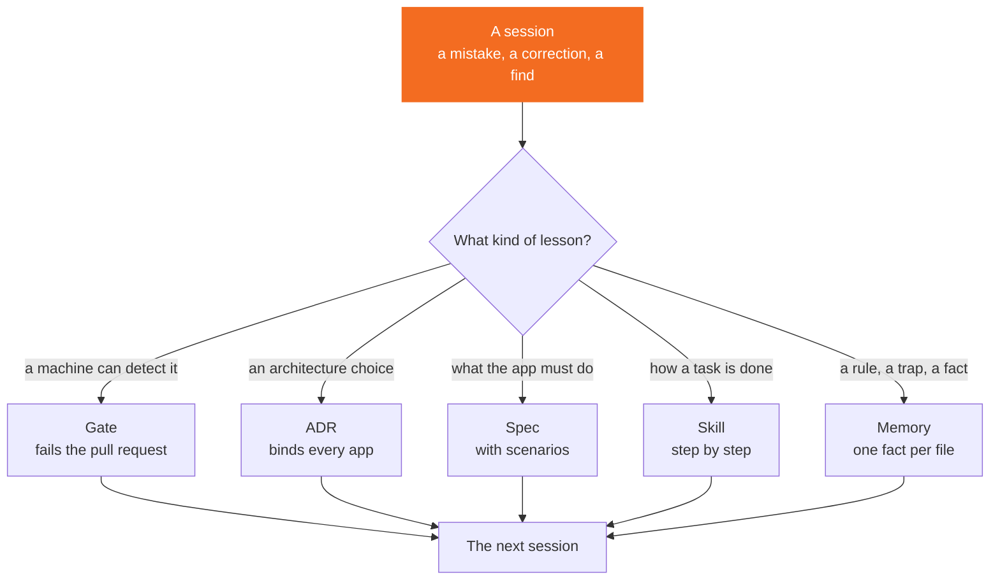
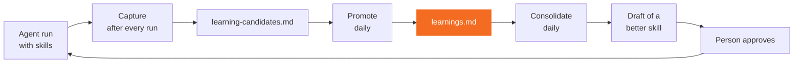

# The learning loop

A language model forgets everything when its session ends. Each new session starts like an intern on day one. If the factory relied on the model to remember, it would make every mistake again, at full speed.

So the factory keeps the memory outside the model, in plain markdown and in code. This page shows where a lesson goes and how it reaches the next session.

## Where a lesson goes

We push every lesson as far up that list as it will go. A gate needs nobody to remember it. A memory works only when a session reads it.

That order comes from experience. The rule against em-dashes in user-facing text was written down, correct and in a skill. It still shipped 126 times across 12 apps, because a skill only applies when someone loads it. Gate 96 now rejects em-dashes in app manifests, so that part can no longer ship.

## Memory as a knowledge graph

Each developer's Claude Code keeps a memory: a folder of markdown files that grows with every session. The memory we build the fleet with holds more than 2,000 files. It works because of its shape:

- **One fact per file.** Each file, a leaf, holds one rule, trap or fact, with why it matters and how to apply it.
- **Hubs group the leaves.** 43 hub files each cover one topic, such as git safety, CI verdicts or OpenRegister behaviour.
- **One root, loaded every session.** A single index file routes each topic to its hub. It has a hard budget of 20 KB, so only the rules that must always apply live there.
- **Links between facts.** A leaf links related leaves with `[[name]]`, so the memory reads as a graph rather than a list.
- **Nothing is deleted.** A fact that turns out wrong is marked as superseded by the fact that replaced it. The history of a decision stays readable.

Before a session plans work on a topic, a small read-only agent searches the graph and returns only what applies. The main session gets the rules without spending its context on the search.

## The weekly harvest

Sessions hold lessons that nobody wrote down at the time. Claude Code deletes old transcripts after 30 days, and those lessons would go with them.

So a timer runs every Monday at 09:00. It reads every session older than a week, extracts the durable lessons and files them into the graph, under the right hub. Whatever is new to the graph gets a leaf. Whatever was already known gets updated.

## Skills that improve

A skill is a written procedure an agent follows, such as running the gates, writing a spec or reviewing a pull request. Hydra carries 126 of them, 62 of which drive a single gate.

We rate skills on seven levels (L1–L7, see [Writing skills](../claude/writing-skills.md)):

| Level | What the skill has |
| --- | --- |
| L1–L2 | A clear procedure, and a description that makes it trigger at the right moment |
| L3–L4 | Proven patterns, examples, and the context of our own codebase |
| L5 | Evals that measure whether it works, run and graded |
| L6 | A learnings loop: what went wrong feeds back into the skill |
| L7 | It orchestrates other agents, and stays measurable while doing so |

Most skills stop at L4. They feel right but nobody has measured them. L5 turns that feeling into evidence.

### How a skill learns

Skills learn on a schedule. Hermiq, our agent app, runs the loop as Nextcloud background jobs, driven by the Nextcloud cron every five minutes:

| Job | When | What it does |
| --- | --- | --- |
| Learnings capture | After every agent run | Writes what the run taught into the skill's `learning-candidates.md` |
| Learnings promotion | Daily | Moves a candidate into `learnings.md` once three separate runs confirm it, or once it explains a failed eval. Drops candidates nobody touched for 30 days. No model is involved, so this step cannot hallucinate. |
| Consolidation | Daily | Turns the learnings into a draft of an improved skill, pre-qualifies it against the evals, and watches for regressions after a person accepts it |
| Curation | Daily | Marks unused skills stale, then archives them. Nothing is deleted. |

ADR-068 sets the one rule that makes this safe: a skill never rewrites itself directly. Every change becomes a draft version that passes an approval, a security re-scan and an eval regression check. Self-modifying skills would otherwise be an open door for prompt injection.

The skills we develop with follow the same pattern. Nineteen Hydra skills keep a `learnings.md` next to their procedure, which the next session reads before it starts.

## Retrospectives

A failure that cost real time gets a written retrospective under [Retrospectives](retrospectives/decidesk-44-45-phase-g.md). It names what happened, why the checks missed it, and which gate, ADR or skill changed as a result.

## Next step

Caught an agent making a mistake for the second time? Decide which of the five homes above it belongs in, and write it there today.
