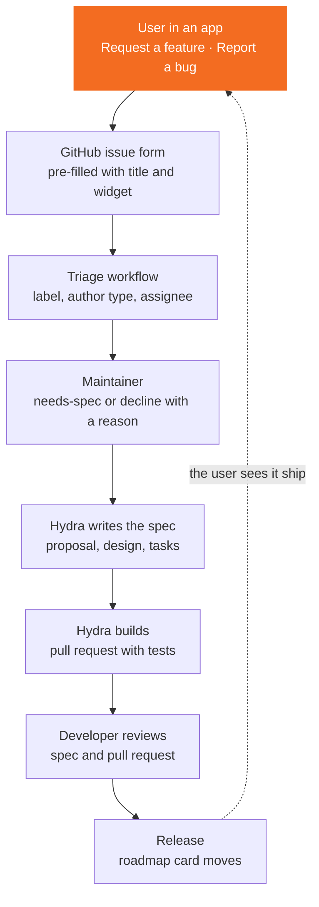

# Users are the moat

Any team with a language model can now ship a working feature from a prompt. So code no longer protects a software company. What still protects us is knowing what our users need before anyone else does. This page explains that bet, and the path a request takes from a user's screen to a released feature.

## The argument

Code is cheap now. Claude, ChatGPT, Qwen and Mistral write a working feature from a prompt. We do not compete on lines of code.

Open specs are cheap too. OpenSpec is a public format, and anyone can feed specs to a model. Our frameworks are open source, and our component library is EUPL. A competitor can fork all of it tonight.

What nobody can fork is the people who use our apps, how they use them, and what they tell us is missing. That knowledge reaches us first. So every part of the product has one job: let user input reach us with the least friction, then turn it into shipped software faster than anyone else.

## The path of a request

### 1. Ask from where you are

Every page and widget has an actions menu with **Request a feature** and **Report a bug**. Each one opens the app's GitHub issue form in a new tab, with the title and the widget already filled in. The user posts under their own GitHub account, so the request carries their name.

We removed the separate suggestion dialog on 4 September 2026. The conversation now happens on GitHub, in English, where other users can read and react to it.

### 2. See what we have and what is coming

Every app has a **Features and roadmap** page with three views:

| View | What it shows | Where it comes from |
| --- | --- | --- |
| Features | What the app does today | The app's specs |
| Capabilities | Each feature next to the products a customer would otherwise buy | `openspec/parity/capabilities.json` |
| Roadmap | Open feature requests, most reactions first | The app's GitHub issues |

A thumbs-up on an issue is a vote. The roadmap sorts on it, so the requests most users want rise to the top.

### 3. Triage

The shared `issue-triage.yml` workflow runs in 29 app repositories. It labels every new issue `triage`, records whether the author is a community member or a colleague, and assigns the maintainer on duty.

The maintainer then picks one of two outcomes. Either the issue gets `needs-spec`, or it is closed with a public reason. We explain a decline and never leave a request unanswered.

### 4. From issue to spec

Hydra checks for `needs-spec` every ten minutes. It clones the app, runs `/opsx-new` and `/opsx-ff` on the issue, and commits a proposal, a design and a task list. The change records the issue it came from, so the spec, the code and the release all trace back to the request.

Hydra then labels the issue for the [build pipeline](../hydra/README.md). A developer reviews the spec together with the pull request it produced, before anything merges. A spec that missed the point is cheaper to fix there than in the code.

## What the issue form captures

The form lives in `.github/ISSUE_TEMPLATE/feature-request.yml`, and every app repository inherits it. The user writes four fields. The rest describes where the user was.

| Field | Written by | Becomes in the proposal |
| --- | --- | --- |
| Problem | User | `## Why` |
| Proposed solution | User | `## What Changes` |
| Who benefits | User | Scope and affected projects |
| How important is this to you | User | Triage priority |
| App, page, surface, object | The app | Where the request came from |
| Related capability (`spec-ref`) | The app | Whether this modifies an existing capability or adds one |

Every value is a visible field in the issue. The user can correct it, and a reader sees the same context as the maintainer.

## The other half of demand: research

Users tell us what they miss. Tenders and competitors tell us what the market expects. Specter, our research pipeline, reads public tenders and competitor documentation. It turns them into the capability matrix of each app.

For humaniq, the matrix lists 40 features. It sets each one next to products such as AFAS Profit and Visma Raet Youforce, read from their public documents only. Every cell carries a status: in production, in build, in development, requested, on the roadmap or declined. A cell we could not verify says so, and names what we searched.

A request from a user and a gap in the matrix end up in the same place: a spec.

## Credit

A user who sparks a feature should see their name on it. The issue already carries their account, and the spec links back to the issue. We still owe the rest:

- the contributor's login in the spec's `contributors:` field,
- a contributors page on each app's documentation site,
- a message to the contributor when their request changes status.

We do not pay bounties. Recognition and access to the maintainers scale better, and they attract people who care about the product.

## What we still owe

- **Board placement.** The triage workflow labels and assigns, but cannot yet put the issue on the project board. That needs a project-scoped token ([.github#432](https://github.com/ConductionNL/.github/issues/432)).
- **Full context.** The actions menu fills in the title and the widget. Page, object in focus and `spec-ref` still arrive empty.
- **A path without a GitHub account.** Some customers cannot post in public. Their requests should reach us through pipelinq and keep the same status trail.
- **Status notifications.** A contributor should hear when their request is triaged, built or declined, without checking GitHub.

Each of these is its own OpenSpec change.

## Open questions

- **Language.** Most users write Dutch, and the issues are in English. Do we translate, or answer in the user's language?
- **Cross-app requests.** A request filed in pipelinq may belong in OpenRegister. How does it move?
- **Decline reasons.** Free text, or a fixed list such as out of scope, duplicate or technical limit?

## Reference

- Decision: [ADR-018 Features and roadmap menu](https://github.com/ConductionNL/hydra/blob/development/openspec/architecture/adr-018-features-roadmap-menu.md)
- Component: [`CnFeaturesAndRoadmapView`](https://conduction.github.io/nextcloud-vue/components/cn-features-and-roadmap-view) in `@conduction/nextcloud-vue`
- How a request becomes software: [The code factory](../WayOfWork/spec-driven-development.md)

## Next step

Open any of our apps, go to **Features and roadmap**, and add a thumbs-up to the request you need most. Or file your own with **Request a feature**.
